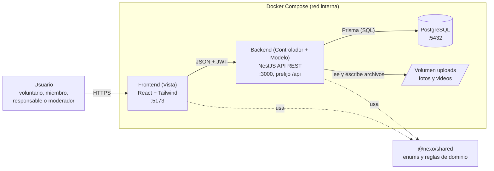
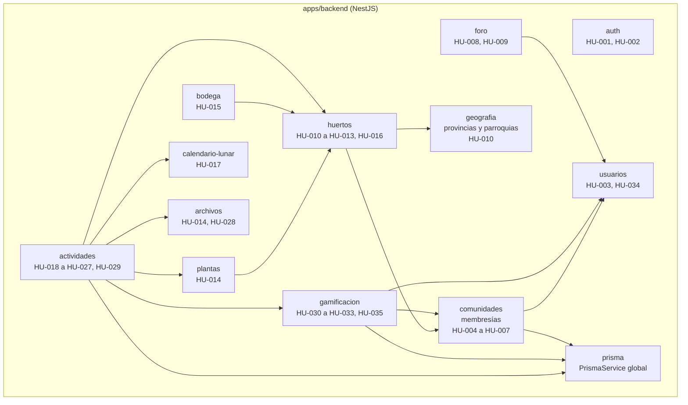
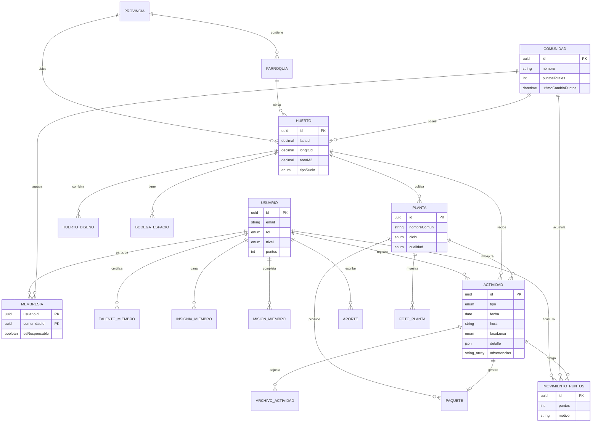
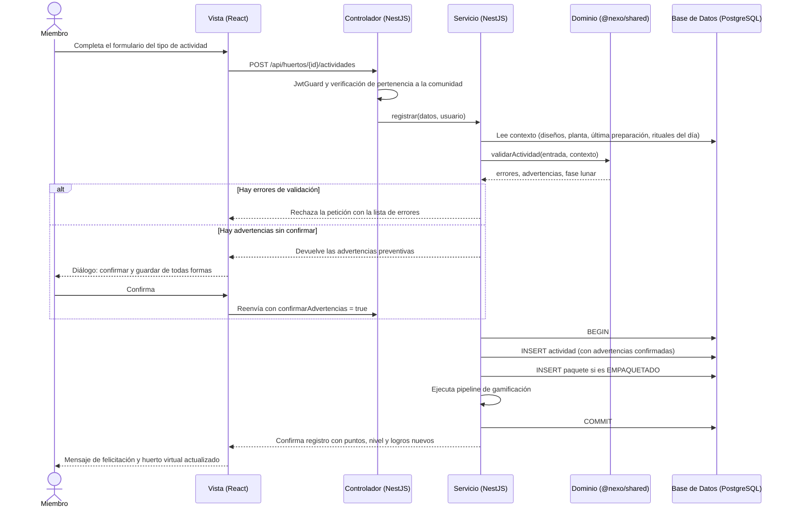
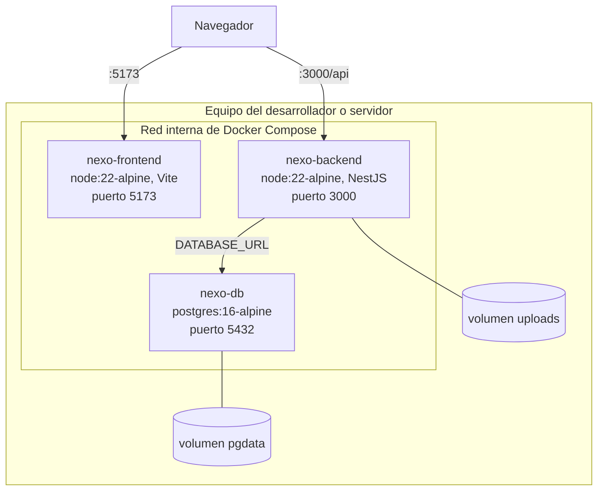

# Arquitectura

## 1. Visión general

**Arquitectura Cliente-Servidor desacoplada (SPA + API REST)** con backend modular en capas, dentro de un monorepo en contenedores Docker Compose.

Tres principios guían el diseño:

1. **Las reglas del dominio viven en `@nexo/shared`** — validación de actividades, fase lunar, gamificación, huerto virtual y ranking. Backend y frontend consumen el mismo paquete; el backend es la autoridad.
2. **Advertir, confirmar y guardar** — las actividades fuera de la práctica recomendada generan advertencias que el usuario confirma; los errores de datos sí bloquean.
3. **Lo derivado no se guarda** — el huerto virtual, el progreso de misiones y el ranking se calculan al consultar.

## 2. Diagrama de contenedores

## 3. Arquitectura modular en capas

Cada módulo de NestJS aplica tres capas internas:  
**Controlador** (rutas HTTP, DTOs, guards)  
**Servicio** (lógica de negocio, reglas del dominio, transacciones)  
**Acceso a datos** (`PrismaService`). Los controladores nunca acceden directamente a la base de datos.

| Módulo | Responsabilidad |
|---|---|
| `auth` | Registro, inicio y cierre de sesión; JWT; guards de rol y pertenencia |
| `usuarios` | Perfil editable; nivel y talentos de solo lectura; progreso personal |
| `comunidades` | Crear y editar comunidad; membresías; ficha con ranking |
| `geografia` | Catálogo de provincias (con región) y parroquias |
| `huertos` | Ubicación, diseño, cerca, recursos y huerto virtual derivado |
| `plantas` | Plantas del huerto con información botánica y fotos |
| `bodega` | Tres espacios: herramientas, semillas/plántulas y abonos |
| `calendario-lunar` | Fase de una fecha o de un mes; actividades recomendadas por fase |
| `actividades` | Un solo servicio para los 13 tipos: valida, guarda, adjunta archivos y dispara gamificación |
| `archivos` | Validación y almacenamiento de fotos y videos |
| `gamificacion` | Puntos, insignias, misiones, talentos, niveles y ranking |
| `foro` | Aportes y moderación |

## 4. Modelo de datos

El esquema completo está definido en `apps/backend/prisma/schema.prisma`.

Decisiones de datos relevantes:

- **`esResponsable` en membresía**, no un rol global. El único rol global adicional es `MODERADOR`.
- **Una sola tabla `ACTIVIDAD`** para los 13 tipos; lo específico de cada una va en `detalle` (JSON). Las advertencias confirmadas se guardan en `advertencias[]`.
- **`MovimientoPuntos`** es el libro de auditoría; `Usuario.puntos` y `Comunidad.puntosTotales` son cachés actualizados en la misma transacción.
- **Catálogos en código** (`@nexo/shared`): insignias, misiones y talentos. La base solo guarda lo ya logrado por cada miembro.
- **`fecha`** es `@db.Date` local Ecuador y **`hora`** es texto `HH:mm`, para evitar errores de zona horaria.

## 5. Flujo de comunicación entre capas: registrar actividad

El mismo endpoint y flujo sirven para los 13 tipos de actividades. Si existen advertencias sin confirmar, el servidor solicita confirmación antes de persistir la transacción:

## 6. Diagrama de despliegue

## 7. Roles y permisos

Todos los permisos se verifican en el servidor mediante guards en la capa de Controlador:

| Funcionalidad | Sin sesión | Voluntario | Miembro | Responsable | Moderador |
|---|:-:|:-:|:-:|:-:|:-:|
| Registrarse e iniciar sesión (HU-001, 002) | ✔ | | | | |
| Editar mis datos personales (HU-003) | | ✔ | ✔ | ✔ | ✔ |
| Crear comunidad (HU-004) | | ✔ | | | |
| Consultar comunidades y ranking (HU-007, 035) | | ✔ | ✔ | ✔ | ✔ |
| Editar comunidad y agregar miembros (HU-005, 006) | | | | ✔ | |
| Registrar huerto, plantas y bodega (HU-010 a 015) | | | | ✔ | |
| Ver huerto virtual y calendario (HU-016, 029) | | | ✔ | ✔ | |
| Registrar actividades y archivos (HU-018 a 028) | | | ✔ | ✔ | |
| Consultar fase lunar (HU-017) | | ✔ | ✔ | ✔ | ✔ |
| Ver progreso, insignias y misiones (HU-031 a 034) | | ✔ | ✔ | ✔ | ✔ |
| Publicar y leer en el foro (HU-008) | | ✔ | ✔ | ✔ | ✔ |
| Retirar aportes del foro (HU-009) | | | | | ✔ |

## 8. Decisiones de arquitectura

| # | Decisión | Motivo |
|---|---|---|
| D1 | SPA + API REST desacoplada | Stack acordado; permite trabajo en paralelo entre frontend y backend en cada Sprint |
| D2 | TypeScript en todo el proyecto | Tipos compartidos y reducción de errores de contrato entre capas |
| D3 | NestJS modular en capas | Módulos alineados al dominio con guards y DTOs integrados |
| D4 | Prisma 6 con PostgreSQL | Migraciones versionadas y cliente tipado |
| D5 | Reglas en `@nexo/shared` con pruebas | Una sola fuente de verdad para frontend y backend |
| D6 | Un endpoint y tabla para los 13 tipos de actividad | Estructura compartida; se agrega un formulario por tipo en cada incremento sin crear nuevos módulos |
| D7 | Fase lunar por algoritmo (1900–2100) | Sin dependencia de internet ni claves externas; precisión ±1 día |
| D8 | JWT con guards de rol y pertenencia | Integración directa y sin estado con React |
| D9 | Error bloquea; advertencia se confirma | Coherente con las historias HU-018 a 027 |
| D10 | Huerto virtual, misiones y ranking derivados | Nunca se desincronizan de la realidad registrada |
| D11 | Libro de puntos con totales en caché | Auditable y recalculable dentro de la misma transacción |
| D12 | Catálogos de insignias, misiones y talentos en código | Versionados y probados sin requerir pantallas de administración |
| D13 | Fecha local como `Date` y hora como texto `HH:mm` | Evita desfases de zona horaria (Ecuador UTC−5) |
| D14 | Monorepo con pnpm y Docker Compose | Entorno estandarizado y reproducible para todo el equipo |