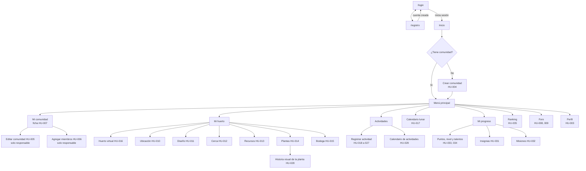

# Diseño

## 1. Principios de diseño

1. **Pensado para usarse en el huerto:** móvil primero, botones grandes, formularios de una sola columna y alto contraste para exteriores.
2. **Que la tierra se parezca a la pantalla:** colores de bosque y tierra, y un huerto virtual que reacciona a cada actividad registrada (HU-016: «retroalimentación visual inmediata»).
3. **Advertir sin regañar:** las advertencias se redactan como recomendaciones del calendario ancestral, y siempre ofrecen «guardar de todas formas».
4. **Cada estado cuenta:** todas las pantallas tienen estado vacío, de error y de carga, porque las historias los piden uno por uno.
5. **Reconocer el saber:** nivel, insignias y talentos se muestran como reconocimiento, con un tono de felicitación sobrio.

## 2. Sistema de diseño

### 2.1 Paleta

| Familia | Uso | Tonos clave |
|---|---|---|
| **primary** | Acciones principales, navegación, progreso | 600 `#2d6e45` botón · 700 hover · 800 barra superior |
| **tierra** | Fondo, bordes, tarjetas cálidas | 50 `#faf6f1` fondo · 100 · 300 bordes |
| **luna** | Texto y superficies neutras | 800 `#1f2937` texto · 600 `#4b5563` secundario |
| **exito / aviso / error / info** | Mensajes: fondo 100 y texto 800 | aviso `#fef3c7` sobre `#7c2d12` |
| **caliente / fria** | Cualidad de la planta (señalética) | caliente `#b42318` · fría `#dcfce7` |
| **nivel-aprendiz / oficial / maestro** | Niveles del voluntario | bronce `#b87333` · plata `#9ca3af` · oro `#d4a017` |

**Contraste verificado (WCAG, mínimo 4,5:1):**

| Par | Relación |
|---|---:|
| Texto principal sobre fondo crema | 13,6 |
| Texto secundario sobre fondo crema | 7,0 |
| Blanco sobre botón primario | 6,1 |
| Blanco sobre botón primario (hover) | 8,2 |
| Aviso (texto sobre fondo) | 8,4 |
| Error (texto sobre fondo) | 6,8 |
| Éxito (texto sobre fondo) | 8,3 |
| Blanco sobre chip «caliente» | 6,6 |
| Blanco sobre barra superior | 10,5 |
| Oro sobre verde oscuro | 6,5 |

### 2.2 Tipografía

| Uso | Fuente | Alternativa si no carga |
|---|---|---|
| Títulos (`font-display`) | Fraunces | Georgia, serif |
| Cuerpo y formularios (`font-sans`) | Inter | system-ui, Segoe UI |

### 2.3 Componentes base

| Componente | Variantes y reglas |
|---|---|
| **Botón** | Primario (verde), secundario (borde verde), peligro (rojo), texto. Alto mínimo 44 px. Estado de carga con texto «Guardando…» |
| **Campo de formulario** | Etiqueta visible arriba, ayuda en `text-sm`, error debajo en rojo con icono. Tipos: texto, correo, contraseña (con mostrar/ocultar), fecha, hora, número, área de texto, lista, casillas, selección múltiple |
| **Mensaje (Banner)** | Éxito, aviso, error, información: icono, texto y borde del mismo color; nunca solo color |
| **Diálogo de advertencias** | Modal ámbar: lista de advertencias, botón «Corregir» (primario) y «Guardar de todas formas» (secundario) |
| **Toast de logro** | Aparece arriba, 6 s, con `aria-live="polite"`: puntos, insignia, misión, talento o nivel |
| **Tarjeta** | Fondo blanco, radio `rounded-tarjeta`, sombra `shadow-tarjeta` |
| **Pestañas** | Para el huerto (ubicación, diseño, cerca, recursos, plantas, bodega) y el progreso |
| **Tabla de datos** | Miembros y ranking; en móvil se convierte en lista de tarjetas |
| **Barra de progreso** | Porcentaje del huerto y avance de misiones (con valor numérico visible) |
| **Chip** | Cualidad de la planta (texto «Caliente» o «Fría» + color) y nivel |
| **Estado vacío** | Ilustración, una frase que explica y un botón de acción |
| **Cargador de archivos** | Vista previa, validación de formato, tamaño y cantidad antes de subir |
| **Selector de mapa** | Leaflet con OpenStreetMap y botón «Usar mi ubicación actual» |
| **Calendario** | Vista mensual para la luna (HU-017) y para las actividades (HU-029) |
| **Emblema de nivel / Tarjeta de insignia** | Insignia desbloqueada a color; bloqueada en gris con su condición |

## 3. Mapa de navegación



**Reglas de navegación**
- Sin sesión, cualquier ruta protegida redirige a `/login` (HU-002).
- Un voluntario sin comunidad ve en Inicio una tarjeta grande «Crea o únete a una comunidad»; las demás secciones del huerto muestran un estado vacío que lo explica.
- Las acciones de edición del huerto y de la comunidad solo aparecen para el **responsable**; «Retirar» en el foro solo para el **moderador**. El servidor igualmente verifica cada permiso.
- **Móvil:** barra inferior con 5 destinos (Inicio, Huerto, **Registrar +**, Ranking, Más). **Escritorio:** menú lateral.

## 4. Inventario de pantallas

| # | Pantalla | Ruta | Historia | Quién | Ola | Estados a diseñar |
|---|---|---|---|---|:-:|---|
| 1 | Registro | `/registro` | 001 | Sin sesión | 1 | Campos obligatorios, correo inválido o repetido, contraseña corta, fecha inválida, éxito |
| 2 | Inicio de sesión | `/login` | 002 | Sin sesión | 1 | Campos vacíos, credenciales incorrectas (mensaje genérico) |
| 3 | Inicio | `/` | 002, 016, 017 | Con sesión | 1 | Sin comunidad; con comunidad (resumen) |
| 4 | Crear comunidad | `/comunidad/nueva` | 004 | Voluntario | 1 | Campos faltantes, contacto inválido |
| 5 | Ficha de comunidad | `/comunidad/:id` | 007 | Con sesión | 2 | Sin miembros adicionales; no encontrada |
| 6 | Editar comunidad | `/comunidad/:id/editar` | 005 | Responsable | 2 | Ranking de solo lectura; sin permiso |
| 7 | Agregar miembros | `/comunidad/:id/miembros` | 006 | Responsable | 2 | No registrado; ya es miembro |
| 8 | Huerto · Ubicación | `/huerto/ubicacion` | 010 | Responsable | 1 | Listas provincia → parroquia, mapa, permiso de ubicación denegado |
| 9 | Huerto · Diseño | `/huerto/diseno` | 011 | Responsable | 2 | Sin selección; tipo sin variante |
| 10 | Huerto · Cerca | `/huerto/cerca` | 012 | Responsable | 3 | Sin selección |
| 11 | Huerto · Recursos | `/huerto/recursos` | 013 | Responsable | 2 | Área inválida; falta suelo, agua o abono |
| 12 | Huerto · Plantas | `/huerto/plantas` | 014 | Responsable | 1 | Listado vacío; foto inválida; campos obligatorios |
| 13 | Huerto · Bodega | `/huerto/bodega` | 015 | Responsable | 3 | Sin espacios; falta descripción |
| 14 | **Huerto virtual** | `/huerto/virtual` | 016 | Miembro | 1 | Sin actividades; sin plantas; progreso |
| 15 | Calendario lunar | `/lunar` | 017 | Con sesión | 1 | Fase no disponible |
| 16 | **Registrar actividad** | `/actividades/nueva` | 018–027 | Miembro | 1 | Errores por campo; **diálogo de advertencias**; logros |
| 17 | Calendario de actividades | `/actividades` | 029 | Miembro | 3 | Sin actividades |
| 18 | Historia visual de la planta | `/plantas/:id/historia` | 028 | Miembro | 3 | Sin archivos; archivo inválido |
| 19 | Mi progreso | `/progreso` | 033, 034 | Con sesión | 2 | Sin progreso (cero puntos, aprendiz) |
| 20 | Insignias | `/progreso/insignias` | 031 | Con sesión | 3 | Todas bloqueadas con su condición |
| 21 | Misiones | `/progreso/misiones` | 032 | Con sesión | 3 | Pendiente, en progreso, completada |
| 22 | Ranking | `/ranking` | 035 | Con sesión | 1 | Sin comunidades; comunidad propia destacada |
| 23 | Foro | `/foro` | 008, 009 | Con sesión | 3 | Sin aportes; aporte vacío; vista del moderador |
| 24 | Perfil | `/perfil` | 003 | Con sesión | 2 | Campos de solo lectura (nivel y talentos) |

## 5. Wireframes de baja fidelidad

Los wireframes muestran estructura y contenido, no el acabado visual. Todos se diseñan para móvil (360 px) y se reacomodan en escritorio.

### 5.1 Registro y acceso (HU-001, HU-002)
```

```

### 5.2 Inicio
```

```

### 5.3 Ubicación del huerto (HU-010)
```

```

### 5.4 Registrar actividad (HU-018 a HU-028) — la pantalla central
```

```

### 5.5 Calendario lunar (HU-017)
```

```

### 5.6 Huerto virtual (HU-016)
```

```

### 5.7 Mi progreso (HU-034, HU-033)
```

```

### 5.8 Ranking (HU-035)
```

```

### 5.9 Foro (HU-008, HU-009) — ola 3
```

```

## 6. Huerto virtual: especificación visual

| Etapa | Recurso | Condición (actividad más avanzada) |
|---|---|---|
| Sin etapa (estado inicial) | `etapa-0-inicial.svg` | Ninguna |
| Tierra preparada | `etapa-1-tierra-preparada.svg` | Preparación de la tierra del huerto |
| Sembrada | `etapa-2-sembrada.svg` | Siembra |
| En cuidado | `etapa-3-en-cuidado.svg` | Cuidado o riego |
| Cosechada | `etapa-4-cosechada.svg` | Cosecha |
| En secado | `etsapa-5-en-secado.svg` | Secado |
| Empaquetada | `etapa-6-empaquetada.svg` | Empaquetado |

- **Diseño de la parcela:** una tarjeta por planta (2 columnas en móvil, 4 en escritorio) con el dibujo de su etapa, el nombre común y el nombre de la etapa en texto.
- **Barra superior:** porcentaje del huerto con `ProgressBar` (valor numérico siempre visible).
- **Transición:** al cambiar de etapa, el dibujo anterior se desvanece y el nuevo entra con una escala breve (300 ms). Con `prefers-reduced-motion` se cambia sin animación.
- **Estados:** *sin actividades* (todas en estado inicial, sin errores); *sin plantas* (parcela vacía con el mensaje «Registra tus plantas» y botón de acción).


## 7. Patrones de interacción

| Situación | Cómo se muestra | Historias |
|---|---|---|
| **Error de datos** | Mensaje bajo cada campo + resumen arriba «Falta completar: …». No se borra lo que el usuario escribió | Todas |
| **Advertencia** | Diálogo ámbar con las recomendaciones; «Corregir» o «Guardar de todas formas»; avisa que se pierde el bono | 018 a 027 |
| **Guardado correcto** | Banner de éxito; si hay logros, toast con puntos y, si corresponde, tarjeta de felicitación (insignia, misión, talento o nivel) | 030 a 033 |
| **Estado vacío** | Ilustración + frase + botón de acción | 007, 008, 015, 016, 028, 029, 035 |
| **Campo gestionado por el sistema** | Se muestra en solo lectura con un candado y la explicación («lo actualiza tu progreso») | 003, 005 |
| **Sin permiso** | El botón no aparece; si se llega por URL, mensaje «No tienes permiso para esta acción» | 005, 009 |
| **Sin sesión** | Redirección a `/login` | 002 |
| **Credenciales incorrectas** | Mensaje genérico que no indica cuál dato falló | 002 |
| **Permiso de ubicación denegado** | Mensaje y se habilitan los campos de coordenadas manuales | 010 |
| **Archivo inválido** | El cargador rechaza y explica el motivo (formato, tamaño o máximo de 5) antes de subir | 014, 028 |
| **Carga** | Esqueletos grises; botones con texto «Guardando…» y deshabilitados | Todas |

**Textos de las advertencias** (para el diálogo; ya están en `@nexo/shared`): fase lunar, espera de 15 días, falta de preparación, ritual previo, horario del ritual de gratitud (5:00 a 7:00), rocío (cosecha antes de las 8:00) y duración del secado (10 a 15 días).

## 8. Responsive y accesibilidad

- **Móvil primero (360 px):** una columna, barra inferior de navegación, botones de 44 px como mínimo, tablas convertidas en tarjetas.
- **Tablet y escritorio:** menú lateral, formularios en dos columnas cuando son largos, huerto virtual en 4 columnas.
- **Accesibilidad:** foco visible en todos los elementos (`:focus-visible`), etiquetas en todos los campos, mensajes de error asociados al campo, `aria-live` en los toasts, contraste verificado, el color nunca es la única señal (la cualidad lleva texto «Caliente» o «Fría», la insignia bloqueada lleva su condición escrita), y animaciones desactivadas con `prefers-reduced-motion`.
- **Idioma:** español; fechas se muestran `dd/mm/aaaa` y viajan como `AAAA-MM-DD`.

