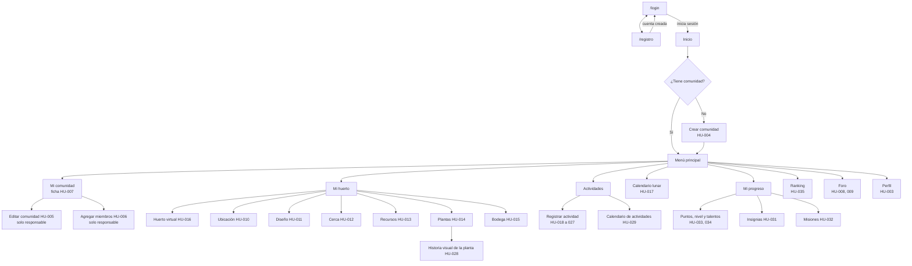

# Diseño

## 1. Principios de diseño

1. **Pensado para usarse en el huerto:** móvil primero, botones grandes, formularios de una sola columna y alto contraste para exteriores.
2. **Que la tierra se parezca a la pantalla:** colores de bosque y tierra, y un huerto virtual que reacciona a cada actividad registrada (HU-016: «retroalimentación visual inmediata»).
3. **Advertir sin regañar:** las advertencias se redactan como recomendaciones del calendario ancestral, y siempre ofrecen «guardar de todas formas».
4. **Cada estado cuenta:** todas las pantallas tienen estado vacío, de error y de carga, porque las historias los piden uno por uno.
5. **Reconocer el saber:** nivel, insignias y talentos se muestran como reconocimiento, con un tono de felicitación sobrio.

## 2. Sistema de diseño

La fuente única del sistema de diseño es [`apps/frontend/DESIGN.md`](../../apps/frontend/DESIGN.md): paleta, tipografía, sombras, formas, componentes y reglas de marca, con los mismos valores que `apps/frontend/src/styles.css`. Este documento no repite esos valores para que no se desactualicen.

Resumen de las decisiones:

- **Color:** fondo de tierra clara (`tierra-50 #fbf6ee`), tarjetas blancas y tinta café cálida (`luna-800 #2a241d`). El verde chakra (`primary-600 #1f7a4d`) se reserva para lo que se puede presionar. El oro (`#c98a12`) solo marca el foco del teclado. No se usan grises fríos.
- **Tipografía:** una sola familia, Nunito Variable, incluida en la app (sin depender de internet). La jerarquía la dan el peso y el tamaño; el cuerpo es de 17 px.
- **Componentes:** botón, campo, selector, casilla, aviso (banner), diálogo de advertencias, toast de logro, tarjeta, chip de cualidad, barra de progreso, estado vacío, navegación y luna. Los componentes de versiones futuras (cargador de archivos, mapa, calendario, tabla, insignias) se diseñan cuando llegue su historia.

## 3. Mapa de navegación

**Reglas de navegación**
- Sin sesión, cualquier ruta protegida redirige a `/login` (HU-002).
- Un voluntario sin comunidad ve en Inicio una tarjeta grande «Crea o únete a una comunidad»; las demás secciones del huerto muestran un estado vacío que lo explica.
- Las acciones de edición del huerto y de la comunidad solo aparecen para el **responsable**; «Retirar» en el foro solo para el **moderador**. El servidor igualmente verifica cada permiso.
- **Móvil (v1):** barra inferior con 4 destinos: Inicio, Mi huerto, **Registrar** y Huerto virtual. **Escritorio:** menú lateral con los mismos destinos. Las secciones de v2 y v3 se suman al menú cuando existan.

El diagrama muestra el mapa completo de las tres versiones; la columna «Versión» del inventario indica cuándo llega cada pantalla.

## 4. Inventario de pantallas

| # | Pantalla | Ruta | Historia | Quién | Versión | Estados a diseñar |
|---|---|---|---|---|:-:|---|
| 1 | Registro | `/registro` | 001, 036 | Sin sesión | v1 | Campos obligatorios, correo inválido o repetido, contraseña corta, fecha inválida, consentimiento sin marcar, éxito |
| 2 | Inicio de sesión | `/login` | 002 | Sin sesión | v1 | Campos vacíos, credenciales incorrectas (mensaje genérico) |
| 3 | Política de privacidad | `/privacidad` | 036 | Todos | v1 | Solo lectura |
| 4 | Inicio | `/` | 002, 017, 030 | Con sesión | v1 | Sin comunidad; con comunidad (recomendación del día, puntos, consejos) |
| 5 | Crear comunidad | `/comunidad/nueva` | 004 | Voluntario | v1 | Campos faltantes, contacto inválido |
| 6 | Ficha de comunidad | `/comunidad/:id` | 007 | Con sesión | v2 | Sin miembros adicionales; no encontrada |
| 7 | Editar comunidad | `/comunidad/:id/editar` | 005 | Responsable | v2 | Ranking de solo lectura; sin permiso |
| 8 | Agregar miembros | `/comunidad/:id/miembros` | 006 | Responsable | v2 | No registrado; ya es miembro |
| 9 | Mi huerto: ubicación y plantas | `/huerto` | 010, 014 | Responsable | v1 | Provincia → parroquia, ubicación del navegador o manual, permiso denegado; plantas vacías y campos obligatorios. El mapa y las fotos llegan en v2 |
| 10 | Huerto · Diseño | `/huerto/diseno` | 011 | Responsable | v2 | Sin selección; tipo sin variante |
| 11 | Huerto · Cerca | `/huerto/cerca` | 012 | Responsable | v2 | Sin selección |
| 12 | Huerto · Recursos | `/huerto/recursos` | 013 | Responsable | v2 | Área inválida; falta suelo, agua o abono |
| 13 | Huerto · Bodega | `/huerto/bodega` | 015 | Responsable | v3 | Sin espacios; falta descripción |
| 14 | **Huerto virtual** | `/huerto/virtual` | 016 | Miembro | v1 | Sin actividades; sin plantas; progreso |
| 15 | Calendario lunar mensual | `/lunar` | 017 | Con sesión | v2 | Fase no disponible. En v1 la fase del día se muestra en Inicio |
| 16 | **Registrar actividad** | `/actividades/nueva` | 018, 021, 023, 025 (v1); 019–027 | Miembro | v1 | Errores por campo; **diálogo de advertencias**; puntos. Los demás tipos llegan en v2 |
| 17 | Calendario de actividades | `/actividades` | 029 | Miembro | v3 | Sin actividades |
| 18 | Historia visual de la planta | `/plantas/:id/historia` | 028 | Miembro | v3 | Sin archivos; archivo inválido |
| 19 | Mi progreso | `/progreso` | 033, 034 | Con sesión | v3 | Sin progreso (cero puntos, aprendiz) |
| 20 | Insignias | `/progreso/insignias` | 031 | Con sesión | v3 | Todas bloqueadas con su condición |
| 21 | Misiones | `/progreso/misiones` | 032 | Con sesión | v3 | Pendiente, en progreso, completada |
| 22 | Ranking | `/ranking` | 035 | Con sesión | v2 | Sin comunidades; comunidad propia destacada |
| 23 | Foro | `/foro` | 008, 009 | Con sesión | v3 | Sin aportes; aporte vacío; vista del moderador |
| 24 | Perfil | `/perfil` | 003 | Con sesión | v2 | Campos de solo lectura (nivel y talentos) |

## 5. Interfaces

Las pantallas de v1 están en dos lugares, en lugar de wireframes de baja fidelidad:

- **Figma:** [Nexo — MVP v1](https://www.figma.com/design/5lN9PIqZZV9XJsqGy1yaiI), con variables, estilos, componentes y las 6 pantallas móviles (390 px). Las pantallas de escritorio (1440 px) están pendientes.
- **Capturas de la app real** en móvil y escritorio: [`docs/capturas/`](../capturas/).

Las pantallas de v2 y v3 se diseñan en Figma al empezar cada versión.

## 6. Huerto virtual: especificación visual

| Etapa | Recurso | Condición (actividad más avanzada) |
|---|---|---|
| Sin etapa (estado inicial) | `etapa-0-inicial.svg` | Ninguna |
| Tierra preparada | `etapa-1-tierra-preparada.svg` | Preparación de la tierra del huerto |
| Sembrada | `etapa-2-sembrada.svg` | Siembra |
| En cuidado | `etapa-3-en-cuidado.svg` | Cuidado o riego |
| Cosechada | `etapa-4-cosechada.svg` | Cosecha |
| En secado | `etapa-5-en-secado.svg` | Secado |
| Empaquetada | `etapa-6-empaquetada.svg` | Empaquetado |

- **Diseño de la parcela:** una tarjeta por planta (2 columnas en móvil, 4 en escritorio) con el dibujo de su etapa, el nombre común y el nombre de la etapa en texto.
- **Barra superior:** porcentaje del huerto con `ProgressBar` (valor numérico siempre visible).
- **Transición («brotar»):** tras registrar una actividad, la planta trabajada muestra 600 ms el dibujo de su etapa anterior y luego la nueva etapa entra con un salto breve (520 ms). Con `prefers-reduced-motion` se cambia sin animación. Detalle en `DESIGN.md`.
- **Etapas:** v1 ya dibuja las 7; las etapas 5 y 6 se alcanzan cuando existan el secado y el empaquetado (v2).
- **Estados:** *sin actividades* (todas en estado inicial, sin errores); *sin plantas* (parcela vacía con el mensaje «Registra tus plantas» y botón de acción).

## 7. Patrones de interacción

| Situación | Cómo se muestra | Historias |
|---|---|---|
| **Error de datos** | Mensaje bajo cada campo + resumen arriba «Falta completar: …». No se borra lo que el usuario escribió | Todas |
| **Advertencia** | Diálogo ámbar con las recomendaciones; «Corregir» o «Guardar de todas formas»; avisa que se pierde el bono | 018 a 027 |
| **Guardado correcto** | Banner de éxito; si hay logros, toast con puntos y, si corresponde, tarjeta de felicitación (insignia, misión, talento o nivel) | 030 a 033 |
| **Estado vacío** | Ilustración + frase + botón de acción | 007, 008, 015, 016, 028, 029, 035 |
| **Campo gestionado por el sistema** | Se muestra en solo lectura con un candado y la explicación («lo actualiza tu progreso») | 003, 005 |
| **Sin permiso** | El botón no aparece; si se llega por URL, mensaje «No tienes permiso para esta acción» | 005, 009 |
| **Sin sesión** | Redirección a `/login` | 002 |
| **Credenciales incorrectas** | Mensaje genérico que no indica cuál dato falló | 002 |
| **Permiso de ubicación denegado** | Mensaje y se habilitan los campos de coordenadas manuales | 010 |
| **Archivo inválido** | El cargador rechaza y explica el motivo (formato, tamaño o máximo de 5) antes de subir | 014, 028 |
| **Carga** | Esqueletos en tono tierra; botones con texto «Guardando…» y deshabilitados | Todas |

**Advertencias del diálogo.** En v1, `@nexo/shared` genera dos: fase lunar (`FASE_LUNAR`) y rocío, cuando se cosecha antes de las 8:00 (`ROCIO`). Las demás llegan con sus actividades en v2: espera de 15 días, falta de preparación, ritual previo, horario del ritual de gratitud (5:00 a 7:00) y duración del secado (10 a 15 días).

## 8. Responsive y accesibilidad

- **Móvil primero (360 px):** una columna, barra inferior de navegación, objetivos táctiles de 44 px como mínimo (botones y campos de 48 px), tablas convertidas en tarjetas.
- **Escritorio (desde 768 px):** menú lateral, formularios en dos columnas cuando son largos, huerto virtual en 4 columnas.
- **Accesibilidad:** foco visible en todos los elementos (`:focus-visible`), etiquetas en todos los campos, mensajes de error asociados al campo, `aria-live` en los toasts, contraste verificado, el color nunca es la única señal (la cualidad lleva texto «Caliente» o «Fría», la insignia bloqueada lleva su condición escrita), y animaciones desactivadas con `prefers-reduced-motion`.
- **Idioma:** español; fechas se muestran `dd/mm/aaaa` y viajan como `AAAA-MM-DD`.

